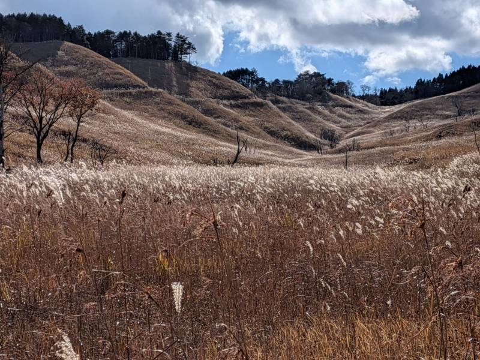
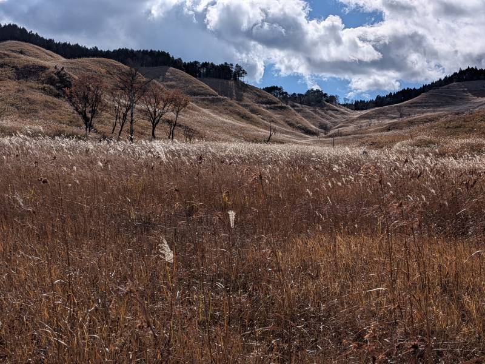
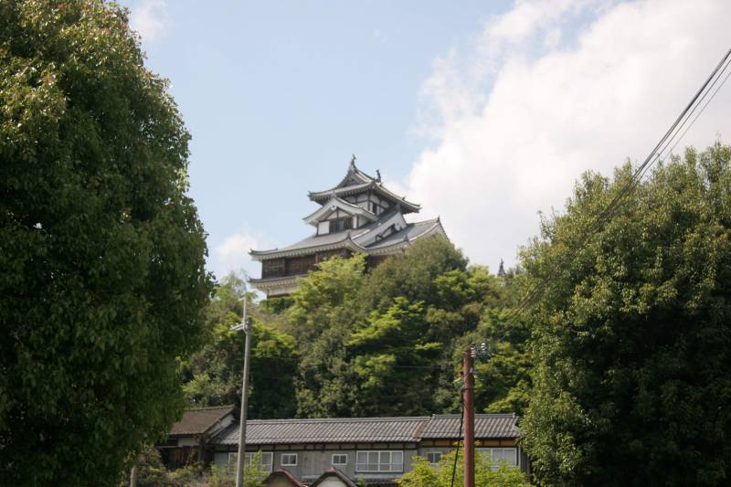
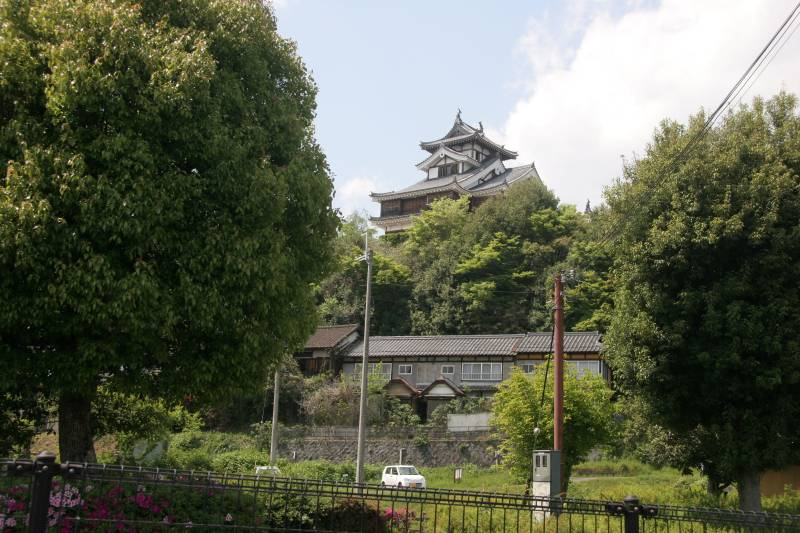
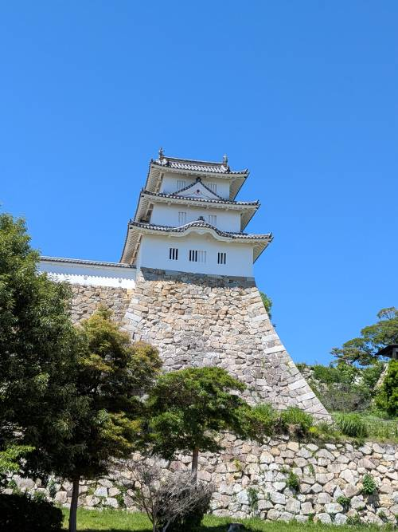
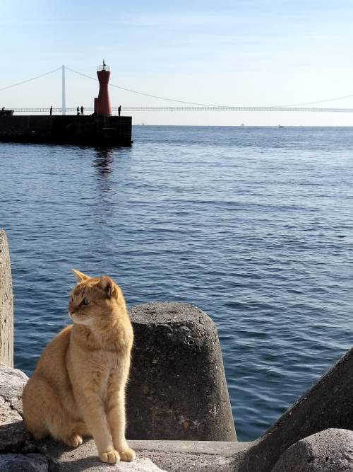

# free-landscape-stock-v2

> CC BY-NC 4.0ライセンスの元で使用できる風景写真素材集

> *注意事項：以前このリポジトリのファイルを破壊してしまい、これはバックアップから復元したものです。*

このリポジトリでは、クリエイティブ・コモンズ・ライセンスの元で使用できる風景写真の素材ストックを掲載しています。

## 何を目的としているか

非営利の個人サイト・ブログの運営者が、風景の情景を説明するために資料として使用する、あるいは、ソフトウェア開発者がテスト用に画像を設置して動作を確認するために使用する、という使い方を想定しています。

## 画像の内容

街並み、自然風景の写真が主にアップロードされています。すべて私が撮影した写真で、AIによる加工はされていません。一部、諸事情でモザイクを入れている画像があります。

## 写真一覧（抜粋）

掲載写真の一部を抜粋しています。全ての一覧は [写真一覧.md](写真一覧.md) をご覧ください。

| 写真 | ファイル | 撮影場所 |
| --- | --- | --- |
|  | kogen_01.jpg | 砥峰高原 |
|  | kogen_02.jpg | 砥峰高原 |
|  | hukuchiyama-jo_01.JPG | 福知山城 |
|  | hukuchiyama-jo_02.JPG | 福知山城 |
|  | midori-koen_01.jpg | 明石城公園 |
|  | umi_01.jpg | 明石 |
|  | cat_01.jpg | 明石 |

- ライセンス：CC BY-NC 4.0（詳しくは `LICENCE.md` をご確認ください）

## 撮影機材

- Google Pixel 9a
- OPPO Reno7 A
- Canon EOS 20D

## ディレクトリの構造

`コンテンツ`ディレクトリの中にすべてのコンテンツが格納されています。`街並みの風景`や、`自然風景`などのシュチュエーションごとに分かれています。

## ライセンスについて

詳しくは、[ライセンスについて](LICENCE.md)をご確認ください。

## 免責事項

- 写真に写っている建造物に対する権利についてお問い合わせがある場合は、`yuuki1365[@]vivaldi.net`までご連絡ください。
- 画像は横画像が長辺800px、縦画像が長辺500px、元画像から70%のJPEGに縮小・圧縮しています。
- `README.md`の執筆については、一部AIの支援を受けて作成しています（画像一覧の部分）。

## お問い合わせに関するお願い

### 営業メールについて

営業メールは送ってこないでください。このプロジェクトの目的はフリーでオープンな風景画像素材を提供する事です。金銭的な利益を追求せず、オープンなインターネットに貢献するためのプロジェクトである事にご留意ください。
